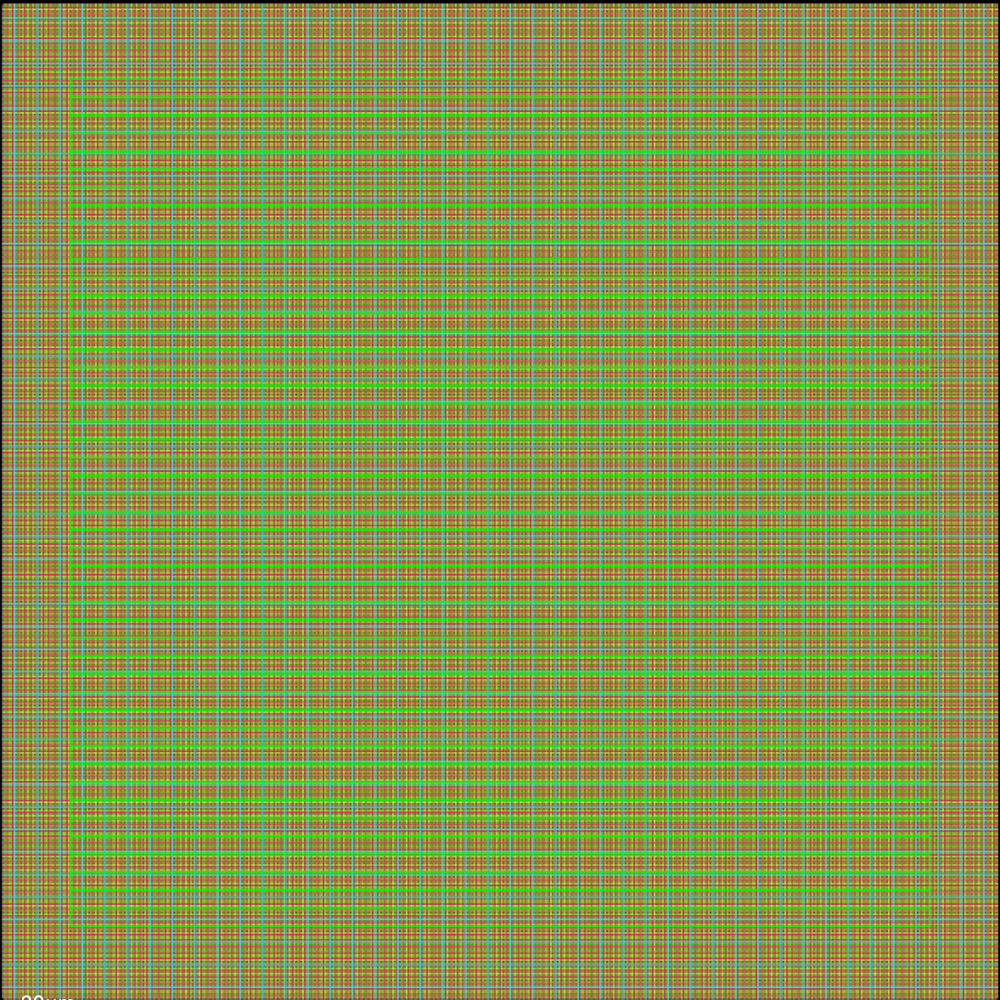
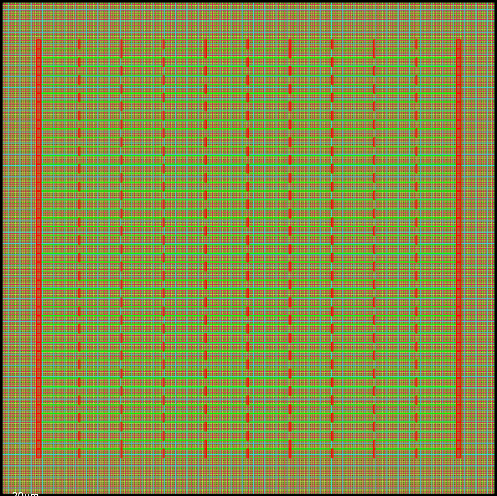
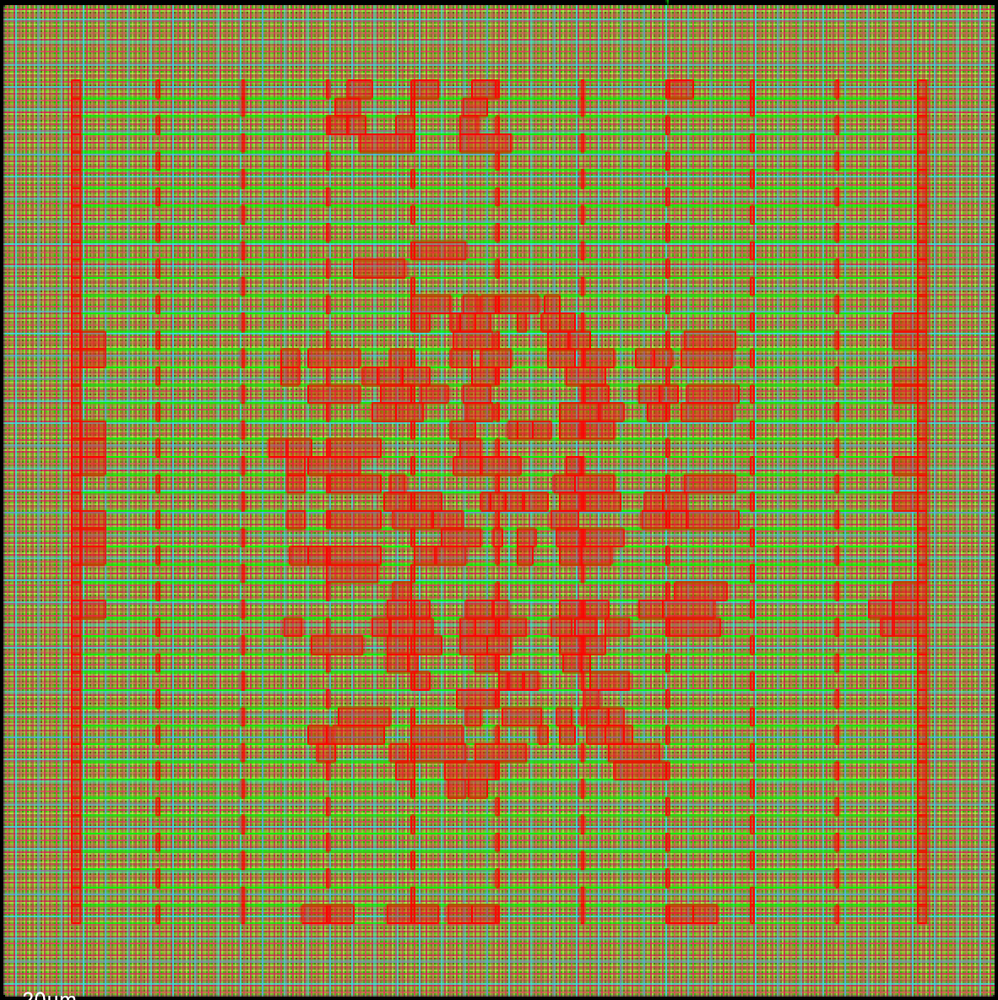
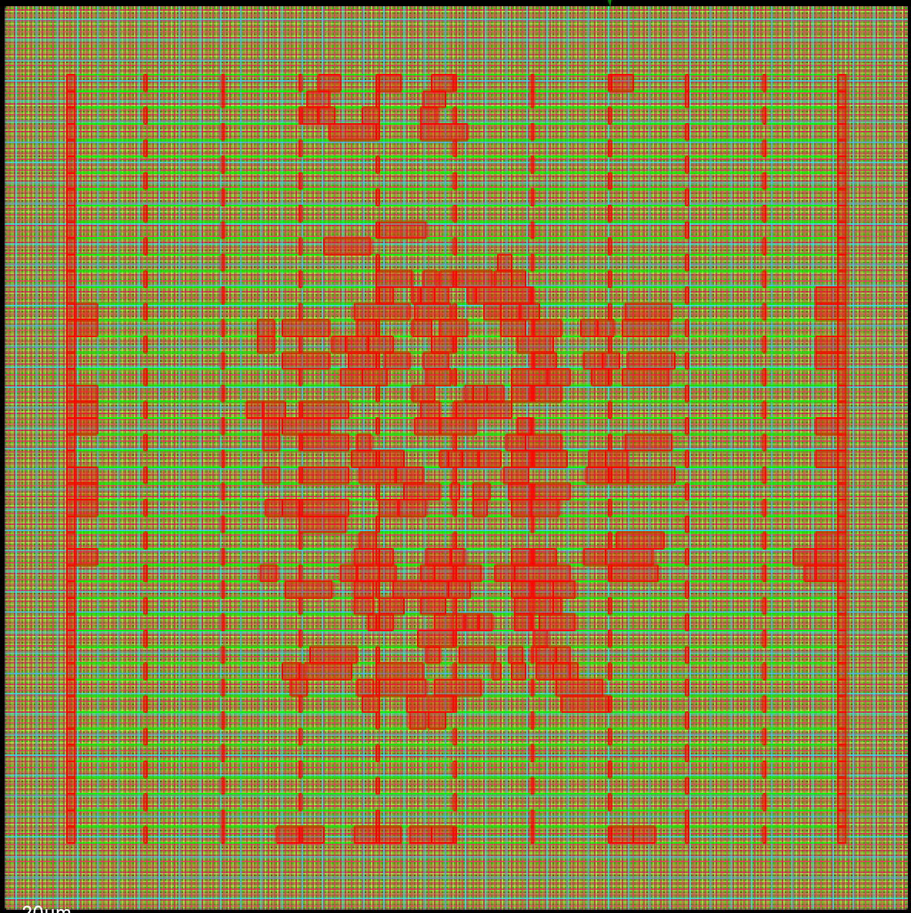
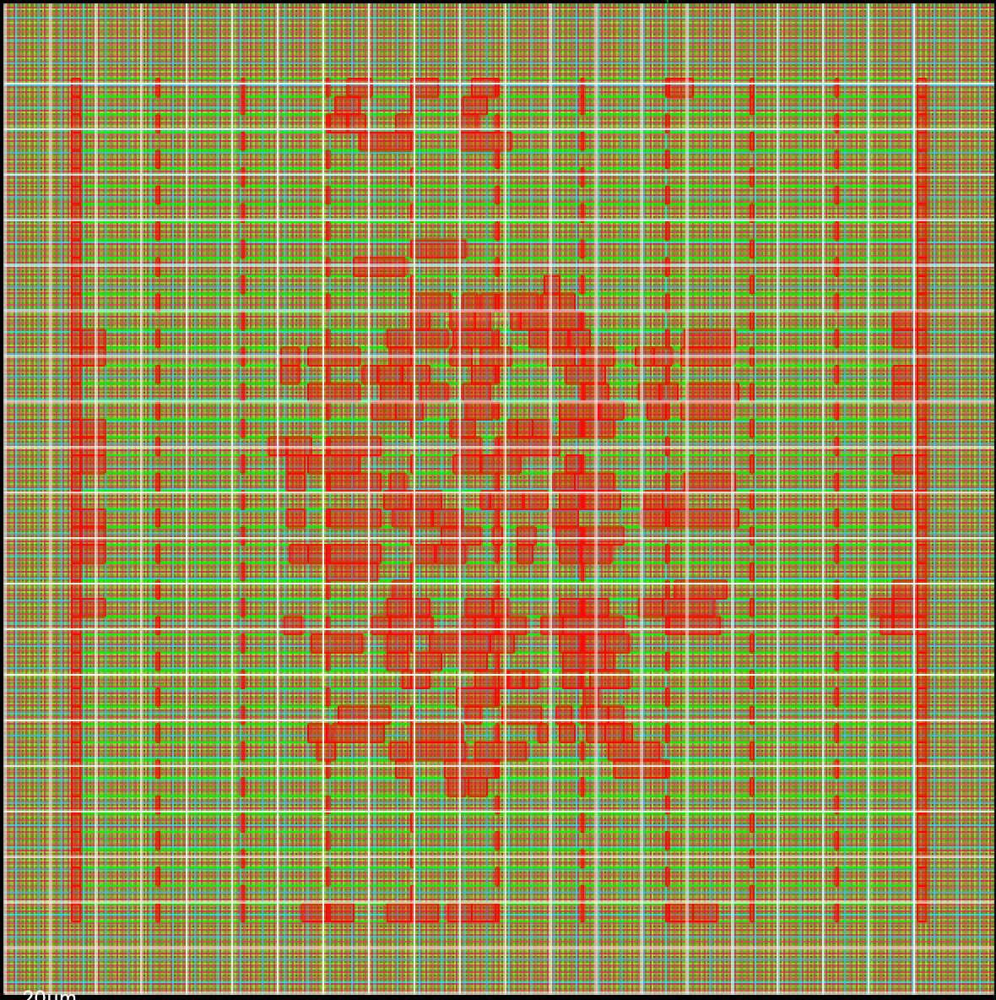
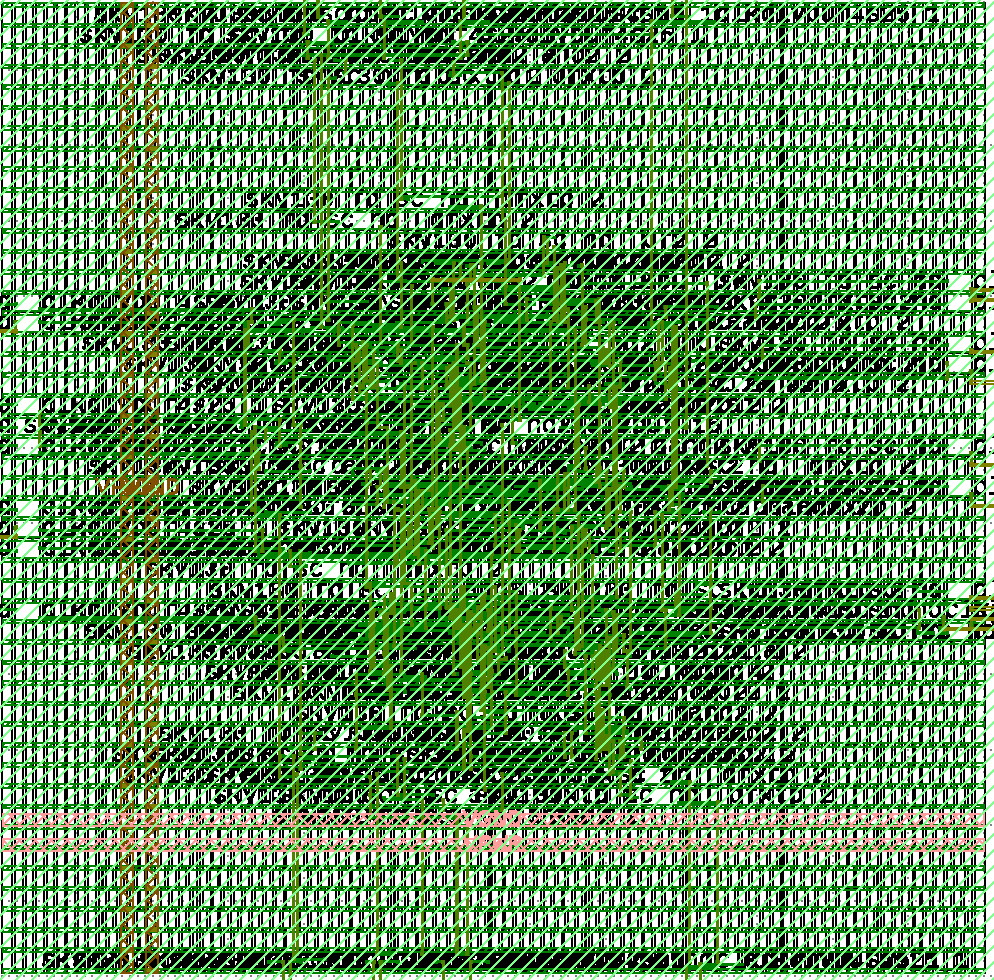

# ASIC 101 — 8-bit ALU

## What this project is

This project is an implementation of an 8 bit arithmetic logic unit. 

## Architecture

The architecture is made of three parts. The adder8 is just the adding logic itself. On top of that is the alu_core which introduces the other operations.
On top that is the alu_top which provides input and output for a synchronized timing path. 

## RTL hierarchy

alu_top is at the top of the hierarchy. It instantiates alu_core which then instantiates adder8.

## Verification

A test bench was used with 524,288 different inputs. Everything passed. There was also physical verification done through DRC and LVS. 

## Open-source toolchain

Used Yosys for synthesization, OpenROAD for physical layout, Icarus Verilog for compiling the Verilog code, 
LibreLane to orchestrate and package the tools needed. 

## PDK and standard-cell library

The Sky130 PDK was used to provide rules for how to design the chip. A standard-cell library was used for predesigned cells we can use. 

## LibreLane configuration

The configuration can be found in config.json files for each architecture. 
The configuration was kept the same except for the architecture in order to ensure that we are only testing the different architectures. 
The clock period is 10ns, die size is 150x150 and core size is 130x130. 
The PDK used is Sky130, standard cell library used is sky130_fd_sc_hd__. 
RTL files were the different adder8.v files for each architecture, alu_core.v, and alu_top.v. Core utilization is 35 and target density is 45. 

## Physical-design flow

### Synthesis

Synthesis was done with Yosys, turning our Verilog into a netlist using the standard cell library we are using. 

### Floorplan

Floorplanning defines the size and shape of our chip. We used a 130x130 core and a 150x150 die. 
The core is smaller than the die becuase we leave extra space for things like input. 

### PDN

The PDN is used to ensure that each cell gets appropriate power. 
Without a PDN we would experience thinge like IR drop which can make gates slower or unreliable. 

### Placement

Placement involves using the netlist to actually figure out where things go. 
This is an optimization problem and is important as it helps us get low latency.

### CTS

Clock Tree Synthesis is used to make sure the clocks are synced up. It distributes clocks through buffers to reduce things like skew. 

### Routing

Routing deals with actual geometry following the PDK's design rules. 

### Parasitics and STA

Parasitics are unintended resistances that can arise after doing the actual physical geometry layout stage of routing. 
Static timing analysis checks timing paths mathematically. 

### Signoff

There are two parts of this. The first is design rule checking. It ensures that the physical geometry is valid. 
The second is layout versus schematic. This matches the layout against the netlist. 

## Baseline PPA

A power, performance, and area analysis was done. 
Results are at reports/ppa_baseline.md 

## Adder architecture experiment

Compared three different achitectures between CLA, Ripple, and Carry Select. Ripple and CLA had identical netlists. Carry Select was faster than both.
However, it required more power and was more complicated. Results are at reports/adder_architecture_comparison.md. 

## Critical-path analysis

The critical path analysis can be found in reports/adder_architecture_comparison.md. 
A key detail is that Carry Select had less cells along its path, explaining the speed. 

## Physical verification summary

All of the checks passed, refer to reports/signoff_summary.md for more information.

## Visual progression

### 1. Floorplanning

### 2. Power Distribution Network

### 3. Placement

### 4. Clock Tree Synthesis

### 5. Routing

### 6. Final GDS

## Reproduction instructions

# Enter LibreLane environment
nix-shell ~/librelane/shell.nix

# Run baseline
cd ~/asic_101/asic
librelane config.json

# Inspect final layout
librelane --last-run --flow OpenInKLayout config.json

## Known issues / unresolved warnings

None

## What remains before fabrication

chip-level integration
pad ring or bump planning
I/O cells
ESD structures
power/ground pads
package planning
clock/reset entry strategy
analog interfaces if needed
foundry/shuttle-specific rules
waivers and signoff requirements
final top-level DRC/LVS/timing/power-integrity checks
manufacturing submission requirements

